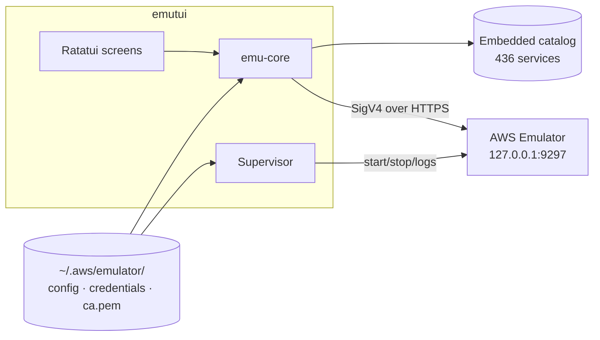

# AWS Emulator TUI

A terminal console for [AWS Emulator](https://github.com/aws/aws-emulator) — browse
resources, create and delete them, invoke any operation, and start or stop the
emulator, without leaving the terminal.

AWS Emulator is a local emulator of the AWS APIs. It has no graphical interface:
you point an SDK or the AWS CLI at `https://127.0.0.1:9297` and drive it with API
calls. This project gives it the interface it lacks. It is an ordinary AWS API
client — it does not fork, patch, or embed the emulator — so it works with the
installed package, the Docker image, or any emulator-compatible endpoint.

```
 AWS EMULATOR TUI │ https://127.0.0.1:9297  ● healthy  │ us-east-1  │ 000000000000 · arn:aws:iam::…/user/emulator
 1 Explorer   2 Console   3 Emulator   4 Requests    tab switch · ? help · q quit
┌ SERVICES ──────────────┐DynamoDB › Tables  (1 row)   enter inspect · c create · d delete · / filter
│ STORAGE                │┌ Tables ──────────────────────────────────────────────────────────────────────────────┐
│ S3              ●      ││ TABLE                                                                                    │
│ DATABASES              ││ orders                                                                                   │
│ DynamoDB        ●      ││                                                                                          │
│ MESSAGING              ││                                                                                          │
│ SQS             ●      ││                                                                                          │
│ SNS             ●      ││                                                                                          │
│ EventBridge     ●      ││                                                                                          │
│ COMPUTE                ││                                                                                          │
│ Lambda          ●      ││                                                                                          │
│ EC2             ●      ││                                                                                          │
│ CONTAINERS             │└──────────────────────────────────────────────────────────────────────────────────────────┘
│ ECS             ●      │┌ detail  orders ──────────────────────────────────────────────────────────────────────────┐
│ ECR             ●      ││{                                                                                         │
│ SECURITY               ││  "Table": {                                                                              │
│ IAM             ●      ││    "AttributeDefinitions": [                                                             │
│ KMS             ●      ││      {                                                                                   │
│ Secrets Manager ●      ││        "AttributeName": "id",                                                            │
│ MANAGEMENT             ││        "AttributeType": "S"                                                              │
│ SSM             ●      ││      }                                                                                   │
│ CloudFormation  ●      ││    ],                                                                                    │
│ CloudWatch Logs ●      ││    "TableName": "orders",                                                                │
│ ORCHESTRATION          ││    "TableStatus": "ACTIVE",                                                              │
│ Step Functions  ●      ││    …                                                                                     │
└─────── a  all services ┘└──────────────────────────────────────────────────────────────────────────────────────────┘
 ↑↓ row · enter inspect · c create · d delete · / filter · v subview · esc back · ? help
```

The screenshot above is an abridged capture (rows and columns elided for
readability); `docs/screenshot-explorer.txt` has the full 150-column version. A
console capture is in `docs/screenshot-console.txt`.

## Why

The emulator is excellent at what it does — a fast, offline AWS API endpoint —
but inspecting what you created usually means another CLI command:

```bash
aws --endpoint-url https://127.0.0.1:9297 s3api list-buckets
aws --endpoint-url https://127.0.0.1:9297 dynamodb list-tables
```

This TUI turns that into a console: a service tree, live resource tables,
details, and actions. It also exposes the long tail — all 436 services and
19,607 operations in the embedded catalog — through a protocol-aware request
console, including services that have no curated screen.

## Features

- **Explorer** — live resource tables for 16 services, with create, inspect, and
  delete actions where the emulator supports them.
- **All services** — press `a` to search the full 436-service catalog; pick a
  service and an operation, edit the JSON input, send it.
- **Protocol aware** — JSON (1.0/1.1), query, EC2 query, and REST-JSON requests
  are shaped and signed correctly. The S3 screen uses REST-XML directly.
- **SigV4** — every request is signed with the credentials the emulator
  generates; works with `--auth on` (the default) and `--auth off`.
- **Emulator supervisor** — start, stop, restart, and tail the emulator's JSON
  logs from the Emulator tab. Started processes run with telemetry off.
- **Request history** — every call is recorded with status, duration, and
  request/response bodies.
- **No web UI, no extra service** — one binary, runs over SSH, uses the
  emulator's own HTTPS endpoint and CA.

## Install

Requirements: a Rust toolchain, and AWS Emulator.

```bash
git clone https://github.com/vinycius/aws-emulator-tui.git
cd aws-emulator-tui
cargo install --path crates/emu-tui
```

This installs `emutui` into `~/.cargo/bin`.

Install the emulator on Linux:

```bash
curl -fsSLo aws-emulator.deb \
  https://downloads.aws.com/aws-emulator/packages/aws-emulator/LTS/latest/aws-emulator_amd64.deb
sudo apt-get install -y ./aws-emulator.deb
```

On macOS and Windows the emulator runs in Docker; point `emutui` at the exposed
port with `--endpoint`.

## Quick start

Start the emulator yourself:

```bash
aws-emulator &
emutui
```

Or start it from the UI: run `emutui`, press `3` for the Emulator tab, then `s`.
When the TUI starts the process it waits for the generated credentials and CA,
reloads them, and begins browsing.

Seed a demo environment:

```bash
./scripts/seed-demo.sh
```

Then press `1` to browse, or `a` to reach any service in the catalog.

### Pointing at another endpoint

```bash
emutui --endpoint https://127.0.0.1:9298
emutui --check
```

Discovery order for the endpoint, credentials, region, and CA:

1. `EMULATOR_ENDPOINT` / `AWS_ENDPOINT_URL`, `AWS_ACCESS_KEY_ID`,
   `AWS_SECRET_ACCESS_KEY`, `AWS_REGION`, `AWS_CA_BUNDLE`.
2. `~/.aws/emulator/<port>/` — `config`, `emulator_credentials`, `ca.pem`.
3. `~/.aws/credentials` and `~/.aws/config`.

`--check` prints a connectivity report and probes all curated services; it is
useful in scripts and CI.

## Keys

| Context | Key | Action |
| --- | --- | --- |
| Global | `1`–`4`, `Tab` | Switch tab |
| Global | `a` | All services (catalog picker) |
| Global | `?`, `F1` | Help |
| Global | `q`, `Ctrl+C` | Quit (stops a TUI-started emulator) |
| Explorer | `h` / `l` | Focus services / resources |
| Explorer | `↑↓` / `j k` | Move selection |
| Explorer | `Enter` | Inspect, or open an S3 bucket |
| Explorer | `Esc` | Close detail / go back |
| Explorer | `c` / `d` | Create / delete |
| Explorer | `r` | Refresh |
| Explorer | `/` / `x` | Filter / clear filter |
| Explorer | `v` | Cycle IAM users and roles |
| Console | `s` / `o` | Pick service / operation |
| Console | `e` | Edit the JSON request |
| Console | `Ctrl+S`, `F5` | Send |
| Console | `r` | Reset body to required fields |
| Console | `[` / `]` | Scroll the response |
| Emulator | `s` / `x` / `R` | Start / stop / restart |
| Emulator | `g` / `c` | Follow / clear logs |
| Emulator | `r` | Reload endpoint, credentials, and CA |
| Requests | `↑↓`, `Enter` | Select, open request detail |
| Requests | `c` | Clear history |

## Services with a curated view

| Service | Views | Create | Delete |
| --- | --- | --- | --- |
| S3 | Buckets, objects | bucket | bucket, object |
| DynamoDB | Tables | table (JSON) | table |
| SQS | Queues | queue | queue |
| SNS | Topics | topic | topic |
| Lambda | Functions | — | function |
| EC2 | Instances | — | — |
| ECS | Clusters | cluster | cluster |
| ECR | Repositories | repository | repository |
| IAM | Users, roles | — | user, role |
| KMS | Keys | key | schedule deletion |
| Secrets Manager | Secrets | secret (JSON) | secret |
| SSM | Parameters | parameter (JSON) | parameter |
| CloudFormation | Stacks | — | stack |
| CloudWatch Logs | Log groups | group | group |
| EventBridge | Event buses | bus | bus |
| Step Functions | State machines | state machine (JSON) | state machine |

Every other service is still reachable through the Console.

## How it works



`emutui` speaks the same APIs as an SDK:

- list calls become tables (`ListBuckets`, `ListTables`, `DescribeInstances`, …);
- the detail pane calls the matching `Describe*`/`Get*` operation;
- actions call `Create*`/`Put*`/`Delete*`;
- the Console signs and sends an arbitrary operation from the catalog.

The catalog is generated from botocore's service models, the same models the
AWS CLI uses, so routing metadata (signing name, protocol, target prefix) and
input skeletons match what AWS expects. The emulator validates the signature
when started with `--auth on`; the generated credentials are read from disk and
never displayed.

### Repository layout

```
crates/emu-core/          catalog, SigV4 client, resource views, supervisor
  assets/catalog.json.gz   generated service catalog
crates/emu-tui/           ratatui interface (binary: emutui)
scripts/generate-catalog.py
scripts/seed-demo.sh
```

### Adding a service view

See [CONTRIBUTING.md](CONTRIBUTING.md#adding-a-resource-view). The short version:
add a `ViewId`, implement its list/parse in `services.rs`, register it in
`CURATED`, and add create/describe/delete calls. All services already work in
the Console; a view is for a friendlier table.

## Development

```bash
cargo fmt --all -- --check
cargo clippy --all-targets -- -D warnings
cargo test --workspace
cargo run -q -p emu-tui -- --check     # requires a running emulator
```

`cargo run -p emu-core --example smoke` probes all curated services and prints
a report. Regenerate the catalog with `python3 scripts/generate-catalog.py`
(needs `pip install botocore`).

The CI workflow runs formatting, clippy, tests, and an end-to-end job that
installs AWS Emulator, starts it, and runs `emutui --check`.

## Limitations

- The emulator is the source of truth for fidelity. A missing operation or a
  wrong response is an emulator gap, not a TUI bug; check its `issues/` folder
  and release fidelity scores.
- List calls show the first page returned. Pagination (`NextToken`) is not
  followed yet.
- The Console shapes REST-JSON and query requests, but not arbitrary REST-XML
  bodies. S3 is covered by its dedicated screens.
- One account and one region, matching the emulator.
- The emulator keeps resources in memory. Stopping it discards everything.
- The TUI reads the emulator's generated credentials; protect your home
  directory as you would `~/.aws`.
- Not affiliated with Amazon Web Services.

## License

MIT. The generated catalog is derived from botocore's service models
(Apache-2.0); see [THIRD_PARTY.md](THIRD_PARTY.md).

AWS and Amazon Web Services are trademarks of Amazon.com, Inc. or its
affiliates. This is an independent project.