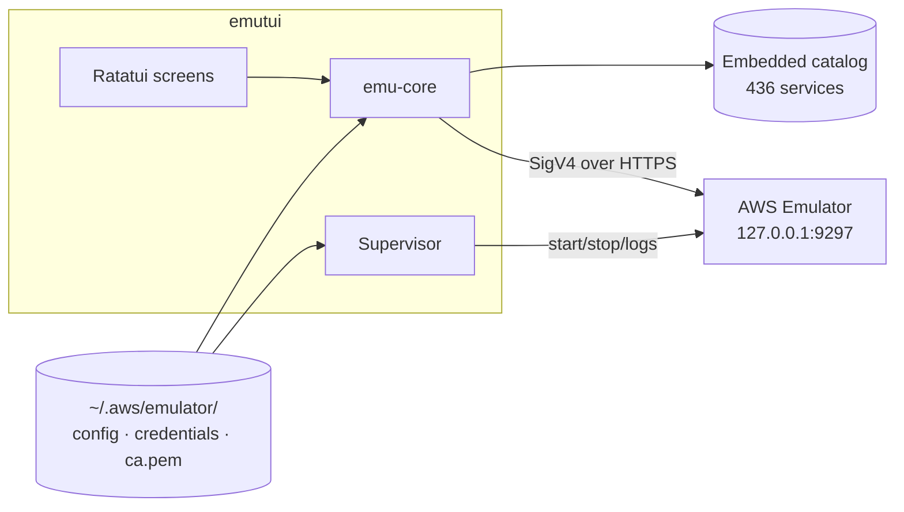

# AWS Emulator TUI

A terminal console for [AWS Emulator](https://github.com/aws/aws-emulator) — browse
resources, create and delete them, invoke any operation, and start or stop the
emulator, without leaving the terminal.

AWS Emulator is a local emulator of the AWS APIs. It has no graphical interface:
you point an SDK or the AWS CLI at `https://127.0.0.1:9297` and drive it with API
calls. This project gives it a terminal interface. It is an ordinary AWS API
client — it does not fork, patch, or embed the emulator — so it works with the
installed package, the Docker image, or any emulator-compatible endpoint.

Community web and desktop consoles exist too; see [Related work](#related-work)
for an honest comparison.

```
 AWS EMULATOR TUI │ https://127.0.0.1:9297  ● healthy  │ us-east-1  │ 000000000000 · arn:aws:iam::…/user/emulator
 1 Explorer   2 Console   3 Emulator   4 Requests    tab switch · ? help · q quit
┌ SERVICES ──────────────┐DynamoDB › Tables  (1 row)   enter inspect · c create · d delete · / filter
│ STORAGE                │┌ Tables ──────────────────────────────────────────────────────────────────────────────┐
│ S3              ●      ││ TABLE                                                                                    │
│ DATABASES              ││ orders                                                                                   │
│ DynamoDB        ●      ││                                                                                          │
│ MESSAGING              ││                                                                                          │
│ SQS             ●      ││                                                                                          │
│ SNS             ●      ││                                                                                          │
│ EventBridge     ●      ││                                                                                          │
│ COMPUTE                ││                                                                                          │
│ Lambda          ●      ││                                                                                          │
│ EC2             ●      ││                                                                                          │
│ CONTAINERS             │└──────────────────────────────────────────────────────────────────────────────────────────┘
│ ECS             ●      │┌ detail  orders ──────────────────────────────────────────────────────────────────────────┐
│ ECR             ●      ││{                                                                                         │
│ SECURITY               ││  "Table": {                                                                              │
│ IAM             ●      ││    "AttributeDefinitions": [                                                             │
│ KMS             ●      ││      {                                                                                   │
│ Secrets Manager ●      ││        "AttributeName": "id",                                                            │
│ MANAGEMENT             ││        "AttributeType": "S"                                                              │
│ SSM             ●      ││      }                                                                                   │
│ CloudFormation  ●      ││    ],                                                                                    │
│ CloudWatch Logs ●      ││    "TableName": "orders",                                                                │
│ ORCHESTRATION          ││    "TableStatus": "ACTIVE",                                                              │
│ Step Functions  ●      ││    …                                                                                     │
└─────── a  all services ┘└──────────────────────────────────────────────────────────────────────────────────────────┘
 ↑↓ row · enter inspect · o children · x action · c create · d delete · y copy · ctrl+p palette
```

The screenshot above is an abridged capture (rows and columns elided for
readability); `docs/screenshot-explorer.txt` has the full 150-column version.
`docs/screenshot-browse.txt` shows the generic browser and
`docs/screenshot-console.txt` shows the API console.

## Why

The emulator is excellent at what it does — a fast, offline AWS API endpoint —
but inspecting what you created usually means another CLI command:

```bash
aws --endpoint-url https://127.0.0.1:9297 s3api list-buckets
aws --endpoint-url https://127.0.0.1:9297 dynamodb list-tables
```

This TUI turns that into a console: a service tree, live resource tables,
details, and actions. It also exposes the long tail — all 436 services and
19,607 operations in the embedded catalog — through a protocol-aware request
console, including services that have no curated screen.

## Features

- **Explorer** — live resource tables for 16 services, with create, inspect,
  delete, and per-row actions (send, publish, invoke, start) where the emulator
  supports them.
- **Browse all services** — a generic, model-free browser over the 436-service
  catalog for the protocols the client shapes (JSON, query, EC2, and
  REST-JSON; S3 has its own screens): pick a service, pick a `List`/`Describe`
  operation, edit the JSON input, and get a table. It finds the records in the
  response, derives the columns, and follows
  `NextToken`/`Marker`/`LastEvaluatedKey` for the next page.
- **Drill-downs** — open the children of a row without leaving the keyboard:
  DynamoDB table → items, SQS queue → messages, log group → streams,
  CloudFormation stack → resources, SNS topic → subscriptions, ECS cluster →
  services, ECR repository → images, and more.
- **Protocol aware** — JSON (1.0/1.1), query, EC2 query, and REST-JSON requests
  are shaped and signed correctly. The S3 screen uses REST-XML directly.
- **SigV4** — every request is signed with the credentials the emulator
  generates; works with `--auth on` (the default) and `--auth off`.
- **Emulator supervisor** — start, stop, restart, and tail the emulator's JSON
  logs from the Emulator tab. Started processes run with telemetry off.
- **Diagnostics** — `D` checks health, identity, credentials, CA, state-dir
  permissions, the binary version, and every curated service probe.
- **Command palette** — `Ctrl+P` or `:` to jump, run diagnostics, toggle
  read-only, export, copy, switch endpoint, and start/stop the emulator.
- **Read-only mode** — blocks writes from create, delete, the console, and
  Browse (prefix-based, a convenience rather than a security boundary).
- **Export and copy** — `Ctrl+E` writes the current table to JSON; `y` copies
  the selected row with OSC52 (works over SSH in terminals that support it).
- **Request history** — every call is recorded with status, duration, and
  request/response bodies.
- **No web UI, no extra service** — one binary, runs over SSH, uses the
  emulator's own HTTPS endpoint and CA. It can even switch between the
  emulator instances it finds under `~/.aws/emulator/`.

## Install

Requirements: a Rust toolchain, and AWS Emulator.

```bash
git clone https://github.com/vinycalves/aws-emulator-tui.git
cd aws-emulator-tui
cargo install --path crates/emu-tui
```

This installs `emutui` into `~/.cargo/bin`.

Install the emulator on Linux:

```bash
curl -fsSLo aws-emulator.deb \
  https://downloads.aws.com/aws-emulator/packages/aws-emulator/LTS/latest/aws-emulator_amd64.deb
sudo apt-get install -y ./aws-emulator.deb
```

On macOS and Windows the emulator runs in Docker; point `emutui` at the exposed
port with `--endpoint`.

## Quick start

Start the emulator yourself:

```bash
aws-emulator &
emutui
```

Or start it from the UI: run `emutui`, press `3` for the Emulator tab, then `s`.
When the TUI starts the process it waits for the generated credentials and CA,
reloads them, and begins browsing.

Seed a demo environment:

```bash
./scripts/seed-demo.sh
```

Then press `1` to browse, or `a` to reach any service in the catalog.

### Pointing at another endpoint

```bash
emutui --endpoint https://127.0.0.1:9298
emutui --check
```

Discovery order for the endpoint, credentials, region, and CA:

1. `EMULATOR_ENDPOINT` / `AWS_ENDPOINT_URL`, `AWS_ACCESS_KEY_ID`,
   `AWS_SECRET_ACCESS_KEY`, `AWS_REGION`, `AWS_CA_BUNDLE`.
2. `~/.aws/emulator/<port>/` — `config`, `emulator_credentials`, `ca.pem`.
3. `~/.aws/credentials` and `~/.aws/config`.

`--check` prints a connectivity report and probes all curated services; it is
useful in scripts and CI.

## Keys

| Context | Key | Action |
| --- | --- | --- |
| Global | `1`–`5`, `Tab` | Switch tab |
| Global | `a` | Browse all services (catalog picker) |
| Global | `Ctrl+P`, `:` | Command palette |
| Global | `Ctrl+E` | Export the current table to JSON |
| Global | `D` | Diagnostics |
| Global | `?`, `F1` | Help |
| Global | `q`, `Ctrl+C` | Quit (stops a TUI-started emulator) |
| Explorer | `h` / `l` | Focus services / resources |
| Explorer | `↑↓` / `j k` | Move selection |
| Explorer | `Enter` | Inspect, preview an S3 object, or open a bucket |
| Explorer | `o` | Open the row's children (items, messages, streams, stacks, …) |
| Explorer | `x` | Per-row action: send, publish, invoke, start execution |
| Explorer | `Esc` | Close detail / go back |
| Explorer | `c` / `d` | Create / delete |
| Explorer | `r` | Refresh |
| Explorer | `/` / `X` | Filter / clear filter |
| Explorer | `y` | Copy the selected row (OSC52) |
| Explorer | `v` | Cycle IAM users and roles |
| Browse | `s` / `o` | Pick service / operation |
| Browse | `e` / `r` | Edit the JSON input / run it |
| Browse | `m` | Load the next page |
| Browse | `Enter` | Open the row as JSON |
| Browse | `/` / `x` | Filter / clear filter |
| Browse | `y` | Copy the selected row |
| Console | `s` / `o` | Pick service / operation |
| Console | `e` | Edit the JSON request |
| Console | `Ctrl+S`, `F5` | Send |
| Console | `r` | Reset body to required fields |
| Console | `[` / `]` | Scroll the response |
| Emulator | `s` / `x` / `R` | Start / stop / restart |
| Emulator | `g` / `c` | Follow / clear logs |
| Emulator | `r` | Reload endpoint, credentials, and CA |
| Requests | `↑↓`, `Enter` | Select, open request detail |
| Requests | `c` | Clear history |

## Services with a curated view

| Service | Views | Create | Delete | Children (`o`) | Action (`x`) |
| --- | --- | --- | --- | --- | --- |
| S3 | Buckets, objects | bucket | bucket, object | objects, preview | — |
| DynamoDB | Tables | table (JSON) | table | items (`Scan`) | — |
| SQS | Queues | queue | queue | messages (`ReceiveMessage`) | send |
| SNS | Topics | topic | topic | subscriptions | publish |
| Lambda | Functions | — | function | event source mappings | invoke |
| EC2 | Instances | — | — | — | — |
| ECS | Clusters | cluster | cluster | services | — |
| ECR | Repositories | repository | repository | images | — |
| IAM | Users, roles | — | user, role | attached policies | — |
| KMS | Keys | key | schedule deletion | grants | — |
| Secrets Manager | Secrets | secret (JSON) | secret | — | — |
| SSM | Parameters | parameter (JSON) | parameter | — | — |
| CloudFormation | Stacks | — | stack | stack resources | — |
| CloudWatch Logs | Log groups | group | group | log streams | — |
| EventBridge | Event buses | bus | bus | rules | — |
| Step Functions | State machines | state machine (JSON) | state machine | executions | start |

Every other service is still reachable through the Console.

## How it works



`emutui` speaks the same APIs as an SDK:

- list calls become tables (`ListBuckets`, `ListTables`, `DescribeInstances`, …);
- the detail pane calls the matching `Describe*`/`Get*` operation;
- actions call `Create*`/`Put*`/`Delete*`;
- the Console signs and sends an arbitrary operation from the catalog.

The catalog is generated from botocore's service models, the same models the
AWS CLI uses, so routing metadata (signing name, protocol, target prefix) and
input skeletons match what AWS expects. The emulator validates the signature
when started with `--auth on`; the generated credentials are read from disk and
never displayed.

### Repository layout

```
crates/emu-core/          catalog, SigV4 client, resource views, supervisor
  assets/catalog.json.gz   generated service catalog
crates/emu-tui/           ratatui interface (binary: emutui)
scripts/generate-catalog.py
scripts/seed-demo.sh
```

### Adding a service view

See [CONTRIBUTING.md](CONTRIBUTING.md#adding-a-resource-view). The short version:
add a `ViewId`, implement its list/parse in `services.rs`, register it in
`CURATED`, and add create/describe/delete calls. All services already work in
the Console; a view is for a friendlier table.

## Development

```bash
cargo fmt --all -- --check
cargo clippy --all-targets -- -D warnings
cargo test --workspace
cargo run -q -p emu-tui -- --check     # requires a running emulator
```

`cargo run -p emu-core --example smoke` probes all curated services and prints
a report. Regenerate the catalog with `python3 scripts/generate-catalog.py`
(needs `pip install botocore`).

The CI workflow runs formatting, clippy, tests, and an end-to-end job that
installs AWS Emulator, starts it, and runs `emutui --check`.

## Related work

There are already ways to look at local AWS resources. This project is the
terminal one built around AWS Emulator's own files and lifecycle.

| Project | Form | Notes |
| --- | --- | --- |
| [StackPort](https://github.com/DaviReisVieira/stackport) | Web console (MIT) | The closest existing project for AWS Emulator: 51 services, 14 dedicated views, an API Explorer with forms and pagination, writes, and activity. Reads the emulator's keys and certificate from `~/.aws/emulator/<port>/`. Python + React, runs from `pip` or Docker. |
| [taws](https://github.com/huseyinbabal/taws) | TUI (MIT, Rust/Ratatui) | 30 services and 51 resource types for real AWS. Supports `--endpoint-url`, `AWS_ENDPOINT_URL`, and `AWS_CA_BUNDLE`, so it can be pointed at an emulator with those three settings. |
| [LocalStack Desktop](https://github.com/localstack/localstack-desktop) | Desktop app | LocalStack only: start/stop, logs, shell, and a resource browser. |
| [lstk](https://docs.localstack.cloud/aws/developer-tools/running-localstack/lstk/) | CLI with a TUI | LocalStack lifecycle and the first-run/startup flow; resource browsing lives in LocalStack Desktop and the web app. |
| [stu](https://github.com/lusingander/stu) / [DDV](https://github.com/lusingander/ddv) | TUI | Single-service explorers for S3 and DynamoDB. |
| [Floci UI](https://github.com/floci-io/floci-ui) / [floci-dash](https://github.com/ofsazib/floci-dash) | Web | Dashboards for the Floci emulator. |
| Moto's `/moto-api/` | Web | A small state-inspection page served by `moto_server`. |

AWS Emulator's issue tracker has an open request for a dashboard:
[aws/aws-emulator#374](https://github.com/aws/aws-emulator/issues/374).

What this project adds to that landscape:

- it is a TUI, so it works over SSH and needs no browser, Python, Node, or
  container;
- it discovers the emulator's endpoint, keys, and certificate by itself, and can
  start, stop, and restart the emulator, tail its JSON logs, and disable
  telemetry for processes it starts;
- its console exposes the emulator's whole wire surface — 436 services and
  19,607 operations — instead of only services with a hand-written screen.

If you want a polished browser console for AWS Emulator today, use StackPort.
If you want a mature TUI for real AWS, use taws. This project is for people who
want both of those things in the terminal.

## Limitations

- The emulator is the source of truth for fidelity. A missing operation or a
  wrong response is an emulator gap, not a TUI bug; check its `issues/` folder
  and release fidelity scores.
- Curated Explorer tables show the first page returned. The Browse tab follows
  `NextToken`, `Marker`, `NextContinuationToken`, and `LastEvaluatedKey`.
- The Console and Browse use a JSON editor, not schema-generated forms.
  Validation is delegated to the emulator.
- REST-XML bodies are only implemented for S3's dedicated screens. The Browse
  tab covers JSON, query, EC2, and REST-JSON services.
- Read-only mode is a prefix-based convenience, not a security boundary. Use
  IAM policy or a read-only credential when you need a guarantee.
- There is no state snapshot or restore yet; the emulator keeps everything in
  memory.
- One endpoint is active at a time. Switching is instant, but history is not
  partitioned per endpoint.
- One account and one region, matching the emulator.
- The emulator keeps resources in memory. Stopping it discards everything.
- The TUI reads the emulator's generated credentials; protect your home
  directory as you would `~/.aws`.
- Not affiliated with Amazon Web Services.

## License

MIT. The generated catalog is derived from botocore's service models
(Apache-2.0); see [THIRD_PARTY.md](THIRD_PARTY.md).

AWS and Amazon Web Services are trademarks of Amazon.com, Inc. or its
affiliates. This is an independent project.