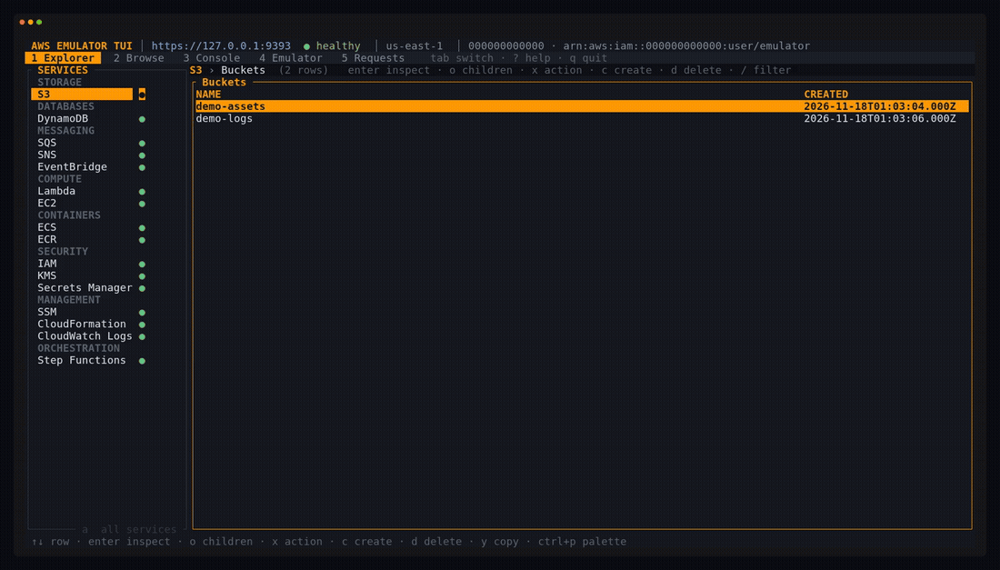

# Demo video



This directory contains a reproducible demo of `emutui`:

- `emutui.tape` — the VHS script (terminal size, theme, key sequence).
- `render-post.sh` — adds the title card, slows the capture to a readable
  pace, appends the closing card, and renders the README GIF.
- `../scripts/demo-setup.sh` — starts an isolated, seeded AWS Emulator on
  port 9393 and writes `demo/env.sh`.

Rendered outputs live in `../docs/demo.mp4` (21 s) and `../docs/demo.gif`
(8 s).

## Reproduce it

Requirements: `vhs`, `ttyd`, `ffmpeg`, and `ffprobe`.

```bash
# VHS is a Go binary; ttyd is a separate binary.
go install github.com/charmbracelet/vhs@latest
# Download ttyd for your platform:
# https://github.com/tsl0922/ttyd/releases

# 1. Start + seed the disposable emulator, write demo/env.sh
./scripts/demo-setup.sh

# 2. Record the raw terminal capture
vhs demo/emutui.tape

# 3. Add intro/outro, slow it down, render the GIF
./demo/render-post.sh

# 4. Stop the demo emulator when done
./scripts/demo-setup.sh --stop
```

The setup script uses `.demo/home`, never your real `~/.aws/emulator`, and
caches the emulator package under `~/.cache/emutui-demo`. It downloads the
official Debian package if `aws-emulator` is not installed.

## Platforms and tools

There is no “AI video platform” that can faithfully render a real terminal UI —
generative video models hallucinate text and windows. The reliable options are:

| Tool | Best for | Notes |
| --- | --- | --- |
| **VHS** | Reproducible scripted demos | This repo uses it. Writes `.tape` files, outputs MP4/GIF/WebM. Requires `ttyd` + `ffmpeg`. |
| **asciinema + agg** | Authentic real-time casts | Record a real session with `asciinema rec demo.cast`; render with `agg demo.cast demo.gif`. Good when timing and idle pauses matter. |
| **OBS Studio** | Narrated 60–90 s demo | Free. Capture a real terminal + microphone; add scenes, callouts, and music in post. The most flexible path. |
| **Screen Studio** (macOS) | Polished auto-zoom | Paid, smooth zooms and cursor emphasis. Great for LinkedIn. |
| **Descript** | Editing by transcript | Paid; remove filler words, add captions, replace “um” with silence. |
| **DaVinci Resolve / Kdenlive / Shotcut** | Free editing | Intro/outro, captions, music, color, export. |
| **Canva / Figma / Remotion / Motion Canvas** | Title cards and callouts | Remotion and Motion Canvas are code-driven; good for repeatable motion graphics. |
| **Synthesia / HeyGen** | AI presenter | Use for a talking head or narration only. Do not fake the terminal with it. |
| **Runway / Pika / Sora** | B-roll / abstract intro | Avoid for UI footage: generated text and interface details are unreliable. |
| **Loom** | Quick internal demo | Fast, but less control over pacing and captions. |

## Recording checklist

- **Aspect ratio:** 16:9 for YouTube/LinkedIn, 1:1 or 9:16 for a vertical cut.
- **Resolution/fps:** 1080p or 1440p at 30 fps; 1440p is crisp on Retina.
- **Terminal:** dark theme, font size 18–22, no transparency, no notifications.
- **Privacy:** use the disposable demo environment. The emulator account is
  `000000000000`; never show real ARNs, access keys, or `~/.aws` paths.
- **Pacing:** 1–3 seconds per state. Cut dead time; the TUI is dense, so let the
  viewer read one table at a time.
- **Motion:** use the keyboard, not the mouse; short jumps, no frantic typing.
- **Audio:** record narration at ~150 wpm. Add captions; LinkedIn autoplays
  muted.
- **Music:** royalty-free only, or no music at all.

## Publishing

| Channel | Length | Format |
| --- | --- | --- |
| GitHub README | 6–10 s GIF, <8 MB | `docs/demo.gif` |
| X / Bluesky | 30–45 s | 16:9 or 1:1, burned-in captions |
| LinkedIn | 60–90 s | 16:9, captions, hook in the first 3 s |
| YouTube | 3–5 min deep dive | 16:9, chapters, voiceover |

Export H.264 MP4 + AAC audio. Keep the repo link in the first line of the post
and in the closing card.

## Shot list

1. **Hook** — “AWS Emulator gives you AWS locally. But there is no console.”
2. **Launch** — `emutui`, endpoint discovered automatically.
3. **Explorer** — S3 buckets → objects → text preview.
4. **Drill-down** — DynamoDB table → `o` → items → JSON detail.
5. **Browse** — service picker → SQS → `ListQueues` → table.
6. **Action** (optional) — SQS send / SNS publish / Lambda invoke.
7. **Daily tools** — command palette, diagnostics, read-only mode.
8. **Outro** — one Rust binary, MIT, repository URL.

The provided tape covers 1–5 and 7; add an action clip if you want a longer
narrative. The voiceover script is in [`voiceover.md`](voiceover.md).